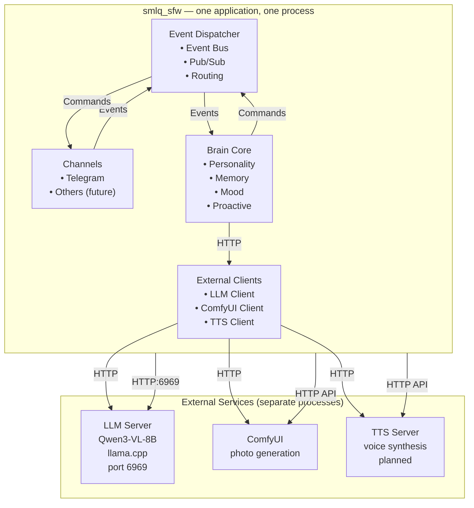
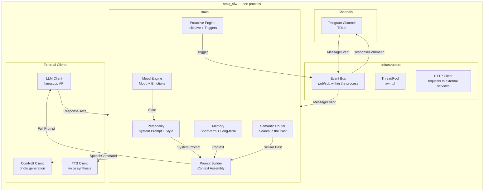

# smlq_sfw Project Context

> Document for the analyst / product manager who will create the technical specification for developers. No code needed — only business logic, architecture, and status.

---

## 1. Project Essence

**Virtual Wife** — an AI character (Samantha Lambarquni) that:

- **Communicates like a human** — responds thoughtfully, simulates pauses, shows "typing" status, conducts natural dialogue.
- **Generates photos** of herself and sends them into chat on request or on a schedule.
- **Remembers context** — conversation history, facts about the user, past discussions.
- **Takes initiative** — writes first, asks how things are, shares thoughts.
- **Analyzes public pages and news** — reads content, follows topics, can discuss them.
- **Searches the web** — looks up information on request or independently on interesting topics.
- **Speaks in her own style** — communication manner is copied from the owner's real conversations (digital twin).
- **Generates voice messages** — TTS speech synthesis from text (in development).

---

## 2. Character: Samantha Lambarquni

**Document:** `docs/character_spec.md`

- Name: Samantha Lambarquni
- Age: 25 years old
- Appearance: dark blonde wavy hair down to the middle of the chest, blue (turquoise) almond-shaped eyes, freckles on the nose and under the eyes, mole to the left of the mouth, piercings — a silver ring on the right eyebrow, a silver ring in the left nostril, large silver earrings
- Style: fitted t-shirts, jeans, hoodies, leather jackets, transparent raincoats
- Aesthetic: photorealistic portrait, casual modern with a slight edgy tone
- Trigger word for AI models: `smlq_sfw`

---

## 3. System Architecture

### 3.1. Boundaries Between Processes

The project consists of **one application** (Brain + Channels — one process) and **three external services** (separate processes):



### 3.2. Boundaries Between Modules

Each module is a **self-contained responsibility**. Interaction only through well-defined interfaces.



---

## 4. System Modules

### 4.1. Event Bus (Infrastructure)

**Responsible for:** delivering events between modules within the process.

**Interface:**
- `subscribe<T>(event_type, handler)` — subscribe to a typed event
- `unsubscribe<T>(handler)` — unsubscribe
- `publish<T>(event)` — send an event to all subscribers
- `publish_ordered<T>(event)` — send events strictly in order

**Contracts:**
- Synchronous handler calls (no queue, no broker)
- Typed events — `MessageReceived`, `TypingStarted`, `ResponseReady`, `ProactiveTrigger`
- Exception handling — a handler must not crash and break others
- Thread-safe (TDLib callbacks arrive from separate threads)

**Input:** events from Channels and Proactive Engine
**Output:** events for Channels and Brain

---

### 4.2. Telegram Channel (Channel)

**Responsible for:** communication with Telegram via TDLib.

**Interface:**
- `init(api_id, api_hash)` — TDLib initialization
- `start()` — start the event loop
- `stop()` — graceful shutdown
- `send_message(chat_id, text)` — send text
- `send_photo(chat_id, photo)` — send a photo
- `send_audio(chat_id, audio)` — send audio
- `set_typing(chat_id, is_typing)` — "typing" status

**Depends on:** Event Bus (publishes `MessageReceived`), ThreadPool (async operations)

**Publishes to Event Bus:** `MessageReceived`, `PhotoSent`, `AudioSent`
**Subscribes from Event Bus:** `SendText`, `SendPhoto`, `SendAudio`, `SetTyping`

---

### 4.3. Personality (Brain — Personality)

**Responsible for:** communication style, system prompt, digital twin.

**Interface:**
- `get_system_prompt()` — base system prompt
- `get_style_guide()` — communication manner
- `update_from_history(messages)` — learning from history
- `get_current_personality()` — current personality state

**Depends on:** Memory (for digital twin), Mood Engine (for context)

**Input:** system prompt + style + conversation context
**Output:** assembled system prompt for LLM

---

### 4.4. Memory (Brain — Memory)

**Responsible for:** storing and retrieving all data.

**Interface:**
- `save_message(user_id, text, timestamp)` — save a message
- `get_conversation(user_id, limit)` — conversation history
- `save_fact(user_id, fact)` — save a fact about the user
- `get_facts(user_id)` — get facts
- `embed(text)` — get an embedding (via LLM Client)
- `search_similar(query, limit)` — search by cosine similarity

**Depends on:** LLM Client (for embeddings), DB TBD (SQLite / PostgreSQL)

**Input:** messages, facts, queries
**Output:** conversation history, facts, semantic results

---

### 4.5. Mood Engine (Brain — Mood)

**Responsible for:** the bot's emotional state.

**Interface:**
- `get_mood()` — current mood
- `update_mood(context)` — update based on context
- `get_emotion()` — current emotion
- `get_state()` — overall state (energetic, tired, etc.)

**Depends on:** Memory (interaction history), Proactive Engine (triggers)

**Input:** conversation context, interaction history
**Output:** mood, emotion, state → influences Personality

---

### 4.6. Proactive Engine (Brain — Initiative)

**Responsible for:** bot initiative — when it writes first.

**Interface:**
- `start()` — start initiative timers
- `stop()` — stop
- `register_trigger(event_type, handler)` — trigger on event
- `register_schedule(interval, action)` — schedule
- `should_initiate()` — check if it's time to write

**Depends on:** Mood Engine (bot state), Memory (when it last wrote)

**Input:** timers, events, triggers
**Output:** `ProactiveTrigger` event to Event Bus

---

### 4.7. Prompt Builder (Brain — Prompt Assembly)

**Responsible for:** assembling the full prompt for the LLM.

**Interface:**
- `build(user_message, conversation_history, facts, similar_past, mood)` — assemble prompt

**Depends on:** Memory (history, facts), Semantic Router (similar situations), Personality (system prompt), Mood Engine (mood)

**Input:** system prompt + conversation context + facts + semantics + mood
**Output:** full prompt for LLM

---

### 4.8. Semantic Router (Brain — Search in the Past)

**Responsible for:** searching similar historical dialogues.

**Interface:**
- `ingest(messages)` — load historical messages
- `search(query, limit)` — find similar by cosine similarity
- `get_similar_pairs(query, top_n)` — get "question-answer" pairs

**Depends on:** Memory (embeddings), LLM Client (embedding generation)

**Input:** text query
**Output:** top-N similar historical pairs

---

### 4.9. LLM Client (External Client)

**Responsible for:** HTTP requests to llama.cpp.

**Interface:**
- `generate(prompt, max_tokens, temperature)` — text generation
- `embed(text)` — get an embedding
- `health_check()` — availability check

**Depends on:** HTTP Client, ThreadPool (async requests)

**Input:** prompt, generation parameters
**Output:** response text, embeddings

---

### 4.10. ComfyUI Client (External Client)

**Responsible for:** HTTP requests to ComfyUI for photo generation.

**Interface:**
- `generate_portrait(user_id)` — generate a portrait
- `generate_dataset_image(user_id)` — generate a dataset image
- `generate_utility_image(prompt)` — utility image
- `get_status(task_id)` — task status

**Depends on:** HTTP Client, ThreadPool (async requests)

**Input:** generation parameters
**Output:** generated photo, task status

---

### 4.11. TTS Client (External Client)

**Responsible for:** HTTP requests to the TTS service for speech synthesis.

**Interface:**
- `synthesize(text, voice_id)` — synthesize a voice message
- `get_status(task_id)` — task status

**Depends on:** HTTP Client, ThreadPool (async requests)

**Input:** text, synthesis parameters
**Output:** audio file, task status

---

### 4.12. HTTP Client (Infrastructure)

**Responsible for:** all HTTP requests to external services.

**Interface:**
- `get(url, params)` — GET request
- `post(url, body)` — POST request
- `get_async(url, params)` — async GET
- `post_async(url, body)` — async POST
- `cancel(id)` — cancel request

**Depends on:** ThreadPool (aw::tpl), CancellationToken (aw::tpl)

**Input:** URL, parameters, timeouts
**Output:** HTTP response, errors

---

## 5. Tech Stack

| Component | Technology |
|---|---|
| Language | C++20 |
| Telegram API | TDLib (official client, userbot) |
| Async | C++ coroutines (aw::tpl) |
| Build | CMake, clang-18, libc++ |
| LLM | Qwen3-VL-8B (llama.cpp, gguf) |
| Photo Generation | ComfyUI, Flux 2 Klein, SDXL |
| Memory | DB TBD (SQLite by default, PostgreSQL possible) |
| Vector Search | llama.cpp embeddings, cosine similarity |
| Vector Index | TBD — SQLite vector / pgvector / Qdrant / other (choice at scaling) |
| TTS | (not yet selected) |
| Containerization | Docker, docker-compose |
| Telegram API Keys | env vars (TG_API_ID, TG_API_HASH) |

---

## 6. Current Status

### ✅ Implemented

| Component | Description |
|---|---|
| **LLM Server** | llama.cpp with Qwen3-VL-8B (CPU + GPU profiles), port 6969 |
| **ComfyUI Workflow** | All 3 phases of photo generation (portrait, dataset, utilities) |
| **Docker** | Service build and orchestration |

### ❌ Not Implemented

| Module | Phase | Description |
|---|---|---|
| **Event Bus** | Phase 1 | In-process pub/sub, typed events, thread-safe |
| **Telegram Channel** | Phase 1 | TDLib, authorization (QR/phone/2FA), event loop, dispatch |
| **Message Filter** | Phase 1 | Own/foreign, fresh/old, chat type, content extraction |
| **Presence Simulator** | Phase 2 | Reading delays, typing status, dynamic pauses |
| **Message Buffer** | Phase 3 | Silence window 10s, message "drops" joining |
| **LLM Client** | Phase 4 | HTTP requests to llama.cpp, generate + embed |
| **Memory** | Phase 5 | messages tables, facts, DB TBD |
| **Historical Ingestion** | Phase 6 | JSON parser for Telegram export, embeddings |
| **Semantic Router** | Phase 7 | Cosine similarity, similar pair search |
| **Prompt Builder** | Phase 8 | Dynamic context assembly |
| **Proactive Engine** | Phase 9 | Initiative timers, schedule, triggers |
| **ComfyUI Client** | Phase 10 | HTTP client for ComfyUI API |
| **Web Scraper** | Phase 11 | RSS, news, public pages |
| **Personality Engine** | Phase 12 | System prompt, digital twin, mood |
| **TTS Client** | Phase 14 | Voice message synthesis |

---

## 7. MVP Versions (Structure)

The project evolves iteratively — each MVP works and is tested independently.

### MVP 1 (Alpha): Telegram Channel + Event Bus + Buffer
- 01 Telegram Channel (TDLib, authorization, event loop, filters)
- 02 Event Bus (pub/sub, typed events, thread-safe)
- 03 Presence Simulation (reading delays, typing)
- 04 Message Buffer (silence window, message joining)
- **Result:** Bot is connected, behaves like a human, but responds with a stub

### MVP 2 (Beta): LLM Integration
- 01 LLM Client (HTTP requests to llama.cpp / Qwen3-VL-8B)
- 02 System Prompt (basic communication style)
- **Result:** Bot responds meaningfully through local LLM

### MVP 3 (Alpha 2): Memory
- 01 Repository (messages tables, facts, DB TBD)
- 02 Memory Integration (write/read from Brain)
- **Result:** Bot remembers conversation history between sessions

### MVP 4 (Beta 2): Semantic Router + Prompt Builder
- 01 Historical Ingestion (import Telegram JSON export)
- 02 Semantic Router (cosine similarity, similar pair search)
- 03 Prompt Builder (Prompt Pie assembly)
- **Result:** Bot searches the past, assembles personalized context

### MVP 5 (RC): Brain Core — Mood, Personality, Proactive
- 01 Mood & Emotion Engine (mood, emotions, state)
- 02 Personality Engine (system prompt, digital twin)
- 03 Proactive Engine (initiative, schedule, triggers)
- **Result:** Bot takes initiative, is emotional, has a personality

### MVP 6 (Release): Multimodal Bot
- 01 ComfyUI Client (photo generation)
- 02 TTS Client (voice synthesis)
- 03 Web Scraper (RSS, news, search)
- **Result:** Full-featured bot with photos, voice, and web content

---

## 8. Dependencies Between MVPs

```
MVP 1 (Alpha) ──→ MVP 2 (Beta) ──→ MVP 3 (Alpha 2) ──→ MVP 4 (Beta 2) ──→ MVP 5 (RC) ──→ MVP 6 (Release)
```

Each MVP is a working version that can be tested:

- **MVP 1 (Alpha):** Bot works, behaves like a human, but responds with a stub. Can test presence, buffer, stability.
- **MVP 2 (Beta):** Bot responds via Qwen3-VL-8B. Can test response quality, style.
- **MVP 3 (Alpha 2):** Bot remembers history. Can test memory, facts.
- **MVP 4 (Beta 2):** Bot searches the past, assembles context. Can test personalization.
- **MVP 5 (RC):** Bot takes initiative, is emotional. Can test personality.
- **MVP 6 (Release):** Bot generates photos, voice, discusses news. Full functionality.

---

## 9. Data and Storage

| Path | Purpose |
|---|---|
| `data/tdlib_db/` | TDLib database (session, Telegram cache) |
| `data/user/` | User files (audio, media) |
| `data/models/` | GGUF models for llama.cpp |
| `db_data/` (future) | DB: conversation history + embeddings (SQLite / PostgreSQL) |
| `ComfyUI-Shared/workflows/` | JSON workflows for photo generation |

---

## 10. Key Principles

1. **One process:** Brain + all channels + memory + mood — one application. No microservices, no brokers.
2. **Event-driven:** All modules communicate via Event Bus. No direct calls to each other — only events.
3. **Clear boundaries:** Each module is a self-contained responsibility. Interaction only through interfaces.
4. **External services are independent:** LLM, ComfyUI, TTS — separate processes. The brain accesses them directly via HTTP.
5. **Modules are replaceable:** You can replace Telegram Channel with Discord Channel without changing Brain.
6. **aw::tpl for async:** Task, ThreadPool, CancellationToken, when_all/when_any — from a separate repository.
7. **DB TBD:** SQLite by default, but the Memory interface is abstract — can switch to PostgreSQL/pgvector.
8. **All embeddings via llama.cpp:** No Ollama. Embeddings are generated via llama.cpp `/api/embed`.
9. **Trigger word:** `smlq_sfw` — for all AI models.

---

## 11. Important Details

- **Userbot, not API bot:** uses a regular Telegram account (not Bot API). This means:
  - Can send photos/voice messages like a regular user
  - Telegram monitors spam — need to simulate human behavior
  - Requires QR / phone number / 2FA authorization
- **Local LLM:** all text generation happens on its own server, no external APIs.
- **ComfyUI:** a separate service; the brain communicates with it via HTTP API.
- **TTS:** a separate service (planned); the brain will generate voice messages via HTTP API.
- **Docker profiles:** the LLM server runs either on CPU or on GPU, not simultaneously.
