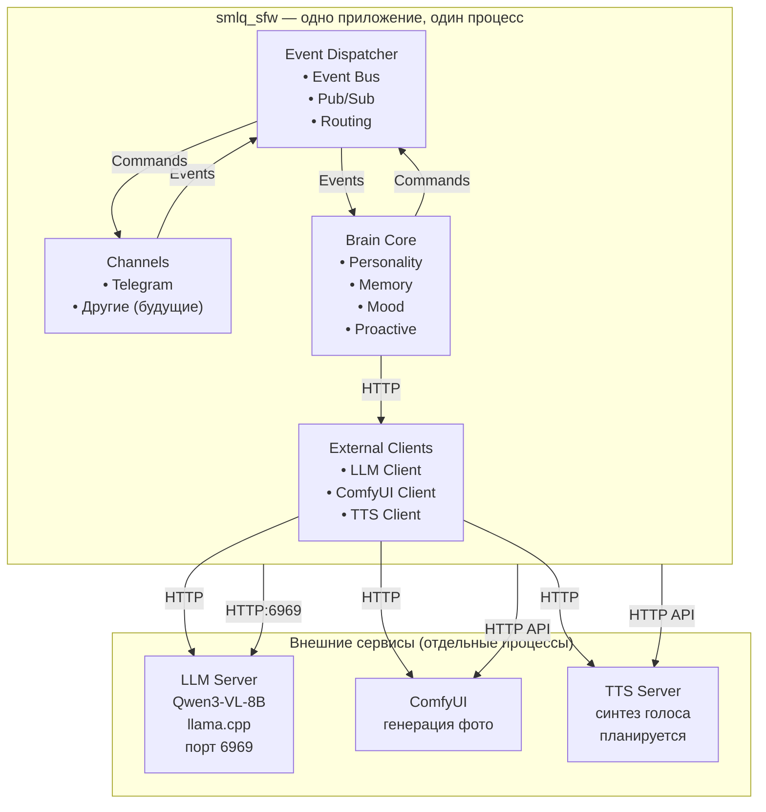
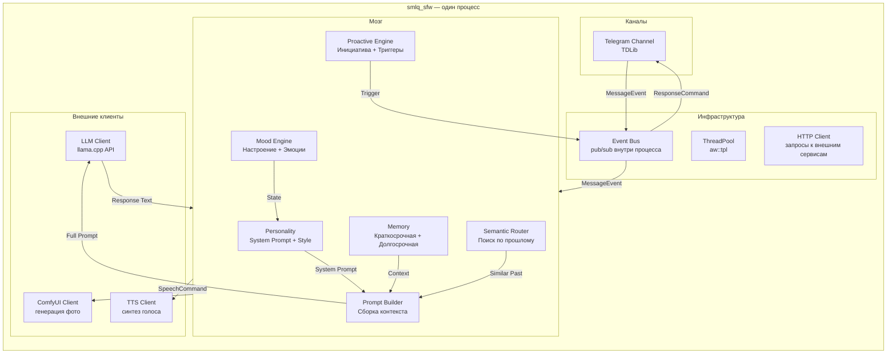

# Контекст проекта smlq_sfw

> Документ для аналитика / продакт-менеджера, который составит ТЗ для разработчиков. Код не нужен — только бизнес-логика, архитектура и статус.

---

## 1. Суть проекта

**Виртуальная жена** — AI-персонаж (Samantha Lambarquni), который:

- **Общается как человек** — отвечает осмысленно, имитирует паузы, статус "печатает", ведёт диалог естественно.
- **Генерирует фото** себя и кидает их в чат по запросу или по расписанию.
- **Помнит контекст** — историю диалогов, факты о пользователе, прошлые разговоры.
- **Проявляет инициативу** — первым пишет, интересуется, как дела, делится мыслями.
- **Анализирует паблики и новости** — читает контент, следит за темами, может обсудить.
- **Гуглит** — ищет информацию по запросу или сам по интересной теме.
- **Говорит в своём стиле** — манера общения копируется из реальных переписок владельца (digital twin).
- **Генерирует голосовые сообщения** — TTS-синтез речи из текста (в разработке).

---

## 2. Персонаж: Samantha Lambarquni

**Документ:** `docs/character_spec.md`

- Имя: Samantha Lambarquni
- Возраст: 25 лет
- Внешность: тёмно-русые волнистые волосы до середины груди, голубые (бирюзовые) миндалевидные глаза, веснушки на носу и под глазами, родинка слева у рта, пирсинг — серебристое кольцо на правой брови, серебристое кольцо в левой ноздре, большие серебряные кольца в ушах
- Стиль: облегающие футболки, джинсы, худи, кожаные куртки, прозрачные дождевики
- Aesthetic: фотореалистичный портрет, casual modern с лёгким edgy оттенком
- Trigger word для AI-моделей: `smlq_sfw`

---

## 3. Архитектура системы

### 3.1. Границы между процессами

Проект состоит из **одного приложения** (Brain + Channels — один процесс) и **трёх внешних сервисов** (отдельные процессы):



### 3.2. Границы между модулями

Каждый модуль — **замкнутая ответственность**. Взаимодействие только через чёткие интерфейсы.



---

## 4. Модули системы

### 4.1. Event Bus (Инфраструктура)

**Отвечает за:** доставку событий между модулями внутри процесса.

**Интерфейс:**
- `subscribe<T>(event_type, handler)` — подписаться на typed event
- `unsubscribe<T>(handler)` — отписаться
- `publish<T>(event)` — отправить событие всем подписчикам
- `publish_ordered<T>(event)` — отправить события строго по порядку

**Контракты:**
- Синхронный вызов handler'ов (без очереди, без брокера)
- Typed events — `MessageReceived`, `TypingStarted`, `ResponseReady`, `ProactiveTrigger`
- Обработка исключений — handler не должен падать и ломать другие
- Thread-safe (TDLib колбэки приходят из отдельных потоков)

**Вход:** события от Channels и Proactive Engine
**Выход:** события для Channels и Brain

---

### 4.2. Telegram Channel (Канал)

**Отвечает за:** связь с Telegram через TDLib.

**Интерфейс:**
- `init(api_id, api_hash)` — инициализация TDLib
- `start()` — запуск event loop'а
- `stop()` — graceful shutdown
- `send_message(chat_id, text)` — отправить текст
- `send_photo(chat_id, photo)` — отправить фото
- `send_audio(chat_id, audio)` — отправить аудио
- `set_typing(chat_id, is_typing)` — статус "печатает"

**Зависит от:** Event Bus (публикует `MessageReceived`), ThreadPool (асинхронные операции)

**Входит в Event Bus:** `MessageReceived`, `PhotoSent`, `AudioSent`
**Входит из Event Bus:** `SendText`, `SendPhoto`, `SendAudio`, `SetTyping`

---

### 4.3. Personality (Мозг — Личность)

**Отвечает за:** стиль общения, system prompt, digital twin.

**Интерфейс:**
- `get_system_prompt()` — базовый системный промпт
- `get_style_guide()` — манера общения
- `update_from_history(messages)` — обучение из истории
- `get_current_personality()` — текущее состояние личности

**Зависит от:** Memory (для digital twin), Mood Engine (для контекста)

**Вход:** системный промпт + стиль + контекст диалога
**Выход:** assembled system prompt для LLM

---

### 4.4. Memory (Мозг — Память)

**Отвечает за:** хранение и retrieval всех данных.

**Интерфейс:**
- `save_message(user_id, text, timestamp)` — сохранить сообщение
- `get_conversation(user_id, limit)` — история диалога
- `save_fact(user_id, fact)` — сохранить факт о пользователе
- `get_facts(user_id)` — получить факты
- `embed(text)` — получить эмбеддинг (через LLM Client)
- `search_similar(query, limit)` — поиск по cosine similarity

**Зависит от:** LLM Client (для эмбеддингов), БД TBD (SQLite / PostgreSQL)

**Вход:** сообщения, факты, запросы
**Выход:** история диалога, факты, семантические результаты

---

### 4.5. Mood Engine (Мозг — Настроение)

**Отвечает за:** эмоциональное состояние бота.

**Интерфейс:**
- `get_mood()` — текущее настроение
- `update_mood(context)` — обновить на основе контекста
- `get_emotion()` — текущая эмоция
- `get_state()` — общее состояние (бодрый, уставший, etc.)

**Зависит от:** Memory (история взаимодействий), Proactive Engine (триггеры)

**Вход:** контекст диалога, история взаимодействий
**Выход:** настроение, эмоция, состояние → влияют на Personality

---

### 4.6. Proactive Engine (Мозг — Инициатива)

**Отвечает за:** инициативу бота — когда он сам пишет первым.

**Интерфейс:**
- `start()` — запуск таймеров инициативы
- `stop()` — остановка
- `register_trigger(event_type, handler)` — триггер на событие
- `register_schedule(interval, action)` — расписание
- `should_initiate()` — проверка, пора ли писать

**Зависит от:** Mood Engine (состояние бота), Memory (когда последний раз писал)

**Вход:** таймеры, события, триггеры
**Выход:** `ProactiveTrigger` событие в Event Bus

---

### 4.7. Prompt Builder (Мозг — Сборка промпта)

**Отвечает за:** сборку полного промпта для LLM.

**Интерфейс:**
- `build(user_message, conversation_history, facts, similar_past, mood)` — собрать промпт

**Зависит от:** Memory (история, факты), Semantic Router (похожие ситуации), Personality (системный промпт), Mood Engine (настроение)

**Вход:** системный промпт + контекст диалога + факты + семантика + настроение
**Выход:** полный prompt для LLM

---

### 4.8. Semantic Router (Мозг — Поиск по прошлому)

**Отвечает за:** поиск похожих исторических диалогов.

**Интерфейс:**
- `ingest(messages)` — загрузить исторические сообщения
- `search(query, limit)` — найти похожие по cosine similarity
- `get_similar_pairs(query, top_n)` — получить пары "вопрос-ответ"

**Зависит от:** Memory (эмбеддинги), LLM Client (генерация эмбеддингов)

**Вход:** текстовый запрос
**Выход:** топ-N похожих исторических пар

---

### 4.9. LLM Client (Внешний клиент)

**Отвечает за:** HTTP-запросы к llama.cpp.

**Интерфейс:**
- `generate(prompt, max_tokens, temperature)` — генерация текста
- `embed(text)` — получить эмбеддинг
- `health_check()` — проверка доступности

**Зависит от:** HTTP Client, ThreadPool (асинхронные запросы)

**Вход:** промпт, параметры генерации
**Выход:** текст ответа, эмбеддинги

---

### 4.10. ComfyUI Client (Внешний клиент)

**Отвечает за:** HTTP-запросы к ComfyUI для генерации фото.

**Интерфейс:**
- `generate_portrait(user_id)` — сгенерировать портрет
- `generate_dataset_image(user_id)` — сгенерировать изображение для датасета
- `generate_utility_image(prompt)` — утилитарное изображение
- `get_status(task_id)` — статус задачи

**Зависит от:** HTTP Client, ThreadPool (асинхронные запросы)

**Вход:** параметры генерации
**Выход:** сгенерированное фото, статус задачи

---

### 4.11. TTS Client (Внешний клиент)

**Отвечает за:** HTTP-запросы к TTS-сервису для синтеза речи.

**Интерфейс:**
- `synthesize(text, voice_id)` — синтезировать голосовое
- `get_status(task_id)` — статус задачи

**Зависит от:** HTTP Client, ThreadPool (асинхронные запросы)

**Вход:** текст, параметры синтеза
**Выход:** аудиофайл, статус задачи

---

### 4.12. HTTP Client (Инфраструктура)

**Отвечает за:** все HTTP-запросы к внешним сервисам.

**Интерфейс:**
- `get(url, params)` — GET-запрос
- `post(url, body)` — POST-запрос
- `get_async(url, params)` — асинхронный GET
- `post_async(url, body)` — асинхронный POST
- `cancel(id)` — отмена запроса

**Зависит от:** ThreadPool (aw::tpl), CancellationToken (aw::tpl)

**Вход:** URL, параметры, таймауты
**Выход:** HTTP response, ошибки

---

## 5. Tech Stack

| Компонент | Технология |
|---|---|
| Язык | C++20 |
| Telegram API | TDLib (официальный клиент, юзербот) |
| Асинхронность | C++ coroutines (aw::tpl) |
| Сборка | CMake, clang-18, libc++ |
| LLM | Qwen3-VL-8B (llama.cpp, gguf) |
| Генерация фото | ComfyUI, Flux 2 Klein, SDXL |
| Память | БД TBD (SQLite по умолчанию, возможен PostgreSQL) |
| Векторный поиск | llama.cpp embeddings, cosine similarity |
| Векторный индекс | TBD — SQLite vector / pgvector / Qdrant / другой (выбор при масштабировании) |
| TTS | (выбор ещё не сделан) |
| Контейнеризация | Docker, docker-compose |
| API ключи Telegram | env vars (TG_API_ID, TG_API_HASH) |

---

## 6. Текущий статус

### ✅ Реализовано

| Компонент | Описание |
|---|---|
| **LLM-сервер** | llama.cpp с Qwen3-VL-8B (CPU + GPU профили), порт 6969 |
| **ComfyUI воркфлоу** | Все 3 фазы генерации фото (портрет, датасет, утилиты) |
| **Docker** | Сборка и оркестрация сервисов |

### ❌ Не реализовано

| Модуль | Фаза | Описание |
|---|---|---|
| **Event Bus** | Фаза 1 | Pub/sub внутри процесса, typed events, thread-safe |
| **Telegram Channel** | Фаза 1 | TDLib, авторизация (QR/телефон/2FA), event loop, dispatch |
| **Message Filter** | Фаза 1 | Свои/чужие, свежие/старые, тип чата, извлечение контента |
| **Presence Simulator** | Фаза 2 | Reading delays, typing status, dynamic pauses |
| **Message Buffer** | Фаза 3 | Silence window 10с, склейка "капель" сообщений |
| **LLM Client** | Фаза 4 | HTTP-запросы к llama.cpp, generate + embed |
| **Memory** | Фаза 5 | Таблицы messages, facts, БД TBD |
| **Historical Ingestion** | Фаза 6 | JSON-парсер Telegram-экспорта, эмбеддинги |
| **Semantic Router** | Фаза 7 | Cosine similarity, поиск похожих пар |
| **Prompt Builder** | Фаза 8 | Dynamic сборка контекста |
| **Proactive Engine** | Фаза 9 | Таймеры инициативы, расписание, триггеры |
| **ComfyUI Client** | Фаза 10 | HTTP-клиент к ComfyUI API |
| **Web Scraper** | Фаза 11 | RSS, новости, паблики |
| **Personality Engine** | Фаза 12 | System prompt, digital twin, mood |
| **TTS Client** | Фаза 14 | Синтез голосовых сообщений |

---

## 7. MVP-версии (структура)

Проект развивается итерациями — каждая MVP работает и тестируется отдельно.

### MVP 1 (Alpha): Telegram Channel + Event Bus + Buffer
- 01 Telegram Channel (TDLib, авторизация, event loop, filters)
- 02 Event Bus (pub/sub, typed events, thread-safe)
- 03 Presence Simulation (reading delays, typing)
- 04 Message Buffer (silence window, message joining)
- **Результат:** Бот подключён, ведёт себя как человек, но отвечает заглушкой

### MVP 2 (Beta): LLM Integration
- 01 LLM Client (HTTP-запросы к llama.cpp / Qwen3-VL-8B)
- 02 System Prompt (базовый стиль общения)
- **Результат:** Бот отвечает осмысленно через локальный LLM

### MVP 3 (Alpha 2): Memory
- 01 Repository (таблицы messages, facts, БД TBD)
- 02 Memory Integration (запись/чтение из Brain)
- **Результат:** Бот помнит историю диалогов между сессиями

### MVP 4 (Beta 2): Semantic Router + Prompt Builder
- 01 Historical Ingestion (импорт JSON-экспорта Telegram)
- 02 Semantic Router (cosine similarity, поиск похожих пар)
- 03 Prompt Builder (Prompt Pie assembly)
- **Результат:** Бот ищет в прошлом, собирает персонализированный контекст

### MVP 5 (RC): Brain Core — Mood, Personality, Proactive
- 01 Mood & Emotion Engine (настроение, эмоции, состояние)
- 02 Personality Engine (system prompt, digital twin)
- 03 Proactive Engine (инициатива, расписание, триггеры)
- **Результат:** Бот проявляет инициативу, эмоционален, имеет личность

### MVP 6 (Release): Multimodal Bot
- 01 ComfyUI Client (генерация фото)
- 02 TTS Client (синтез голосовых)
- 03 Web Scraper (RSS, новости, поиск)
- **Результат:** Полноценный бот с фото, голосом и веб-контентом

---

## 8. Зависимости между MVP

```
MVP 1 (Alpha) ──→ MVP 2 (Beta) ──→ MVP 3 (Alpha 2) ──→ MVP 4 (Beta 2) ──→ MVP 5 (RC) ──→ MVP 6 (Release)
```

Каждая MVP — работающая версия, которую можно протестировать:

- **MVP 1 (Alpha):** Бот работает, ведёт себя как человек, но отвечает заглушкой. Можно тестировать presence, buffer, стабильность.
- **MVP 2 (Beta):** Бот отвечает через Qwen3-VL-8B. Можно тестировать качество ответов, стиль.
- **MVP 3 (Alpha 2):** Бот помнит историю. Можно тестировать память, факты.
- **MVP 4 (Beta 2):** Бот ищет в прошлом, собирает контекст. Можно тестировать персонализацию.
- **MVP 5 (RC):** Бот проявляет инициативу, эмоционален. Можно тестировать личность.
- **MVP 6 (Release):** Бот генерирует фото, голос, обсуждает новости. Полный функционал.

---

## 9. Данные и хранилище

| Путь | Назначение |
|---|---|
| `data/tdlib_db/` | База TDLib (сессия, кэш Telegram) |
| `data/user/` | Пользовательские файлы (аудио, медиа) |
| `data/models/` | GGUF-модели для llama.cpp |
| `db_data/` (будет) | БД: история диалогов + эмбеддинги (SQLite / PostgreSQL) |
| `ComfyUI-Shared/workflows/` | JSON-воркфлоу для генерации фото |

---

## 10. Ключевые принципы

1. **Один процесс:** Мозг + все каналы + память + настроение — одно приложение. Нет микросервисов, нет брокеров.
2. **Event-driven:** Все модули общаются через Event Bus. Нет прямых вызовов друг к другу — только события.
3. **Чёткие границы:** Каждый модуль — замкнутая ответственность. Взаимодействие только через интерфейсы.
4. **Внешние сервисы независимы:** LLM, ComfyUI, TTS — отдельные процессы. Мозг ходит в них напрямую через HTTP.
5. **Модули заменяемы:** Можно заменить Telegram Channel на Discord Channel без изменения Brain.
6. **aw::tpl для асинхронности:** Task, ThreadPool, CancellationToken, when_all/when_any — из отдельного репозитория.
7. **БД TBD:** SQLite по умолчанию, но интерфейс Memory абстрактный — можно переключиться на PostgreSQL/pgvector.
8. **Олл эмбеддинги через llama.cpp:** Никакого Ollama. Эмбеддинги генерируются через `/api/embed` llama.cpp.
9. **Trigger word:** `smlq_sfw` — для всех AI-моделей.

---

## 11. Важные детали

- **Юзербот, не API-бот:** используется обычный аккаунт Telegram (не Bot API). Это значит:
  - Можно отправлять фото/голосовые как обычный пользователь
  - Telegram следит за спамом — нужна имитация человеческого поведения
  - Нужна авторизация по QR / номеру телефона / 2FA
- **Локальный LLM:** вся генерация текста происходит на своём сервере, никаких внешних API.
- **ComfyUI:** отдельный сервис, мозг общается с ним через HTTP API.
- **TTS:** отдельный сервис (в планах), мозг будет генерировать голосовые через HTTP API.
- **Docker profiles:** LLM-сервер запускается либо на CPU, либо на GPU, не одновременно.
