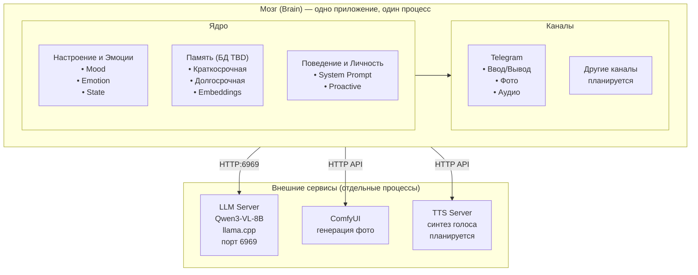

# Контекст проекта smlq_sfw

> Документ для аналитика / продакт-менеджера, который составит ТЗ для разработчиков. Код не нужен — только бизнес-логика, архитектура и статус.

---

## 1. Суть проекта

**Виртуальная жена** — AI-персонаж (Samantha Lambarquni), который:

- **Общается как человек** — отвечает осмысленно, имитирует паузы, статус "печатает", ведёт диалог естественно.
- **Генерирует фото** себя и кидает их в чат по запросу или по расписанию.
- **Помнит контекст** — историю диалогов, факты о пользователе, прошлые разговоры.
- **Проявляет инициативу** — первым пишет, интересуется, как дела, делится мыслями.
- **Анализирует паблики и новости** — читает контент, следит за темами, может обсудить.
- **Гуглит** — ищет информацию по запросу или сам по интересной теме.
- **Говорит в своём стиле** — манера общения копируется из реальных переписок владельца (digital twin).
- **Генерирует голосовые сообщения** — TTS-синтез речи из текста (в разработке).

---

## 2. Персонаж: Samantha Lambarquni

**Документ:** `docs/character_spec.md`

- Имя: Samantha Lambarquni
- Возраст: 25 лет
- Внешность: тёмно-русые волнистые волосы до середины груди, голубые (бирюзовые) миндалевидные глаза, веснушки на носу и под глазами, родинка слева у рта, пирсинг — серебристое кольцо на правой брови, серебристое кольцо в левой ноздре, большие серебряные кольца в ушах
- Стиль: облегающие футболки, джинсы, худи, кожаные куртки, прозрачные дождевики
- Aesthetic: фотореалистичный портрет, casual modern с лёгким edgy оттенком
- Trigger word для AI-моделей: `smlq_sfw`

---

## 3. Архитектура системы

Проект строится вокруг **Мозга** (Brain) — единого модуля, который является сердцем проекта. Telegram-бот — лишь один из каналов ввода/вывода.



### Службы (Docker)

| Сервис | Профиль | Назначение | Порт |
|---|---|---|---|
| `smlq_llamacpp` | `cpu` | LLM сервер (Qwen3-VL-8B Q4) | 6969 |
| `smlq_fast` | `gpu` | LLM сервер (Qwen3-VL-8B Q8, CUDA) | 6969 |

> Telegram-бот и остальные компоненты Мозга пока собираются вместе с LLM-сервером в одном docker-compose. В будущем — разнесём.

---

## 4. Tech Stack

| Компонент | Технология |
|---|---|
| Язык | C++20 |
| Telegram API | TDLib (официальный клиент, юзербот) |
| Асинхронность | C++ coroutines |
| Сборка | CMake, clang-18, libc++ |
| LLM | Qwen3-VL-8B (llama.cpp, gguf) |
| Генерация фото | ComfyUI, Flux 2 Klein, SDXL |
| Память | БД TBD (SQLite по умолчанию, возможен PostgreSQL) |
| Векторный поиск | llama.cpp embeddings, cosine similarity |
| Векторный индекс | TBD — SQLite vector / pgvector / Qdrant / другой (выбор при масштабировании) |
| TTS | (выбор ещё не сделан) |
| Контейнеризация | Docker, docker-compose |
| API ключи Telegram | env vars (TG_API_ID, TG_API_HASH) |

---

## 5. Текущий статус

### ✅ Реализовано

| Компонент | Описание |
|---|---|
| **LLM-сервер** | llama.cpp с Qwen3-VL-8B (CPU + GPU профили), порт 6969 |
| **ComfyUI воркфлоу** | Все 3 фазы генерации фото (портрет, датасет, утилиты) |
| **Docker** | Сборка и оркестрация сервисов |

### ❌ Не реализовано (Мозг + каналы)

| Компонент | Фаза | Описание |
|---|---|---|
| **Telegram-бот (юзербот)** | Фаза 1 | TDLib, авторизация (QR/телефон/2FA), event loop, dispatch обновлений, graceful shutdown |
| **Фильтрация сообщений** | Фаза 1 | Свои/чужие, свежие/старые, тип чата, извлечение контента |
| **Typing simulator** | Фаза 2 | Статус "печатает" с динамическим временем |
| **Reading delays** | Фаза 2 | Пауза 1.5-3с перед ответом, имитация человеческого поведения |
| **Message buffer** | Фаза 3 | Silence window 10с, склейка "капель" сообщений |
| **LLM-клиент** | Фаза 4 | HTTP-запросы к Qwen3-VL-8B, системный промпт |
| **Memory (БД)** | Фаза 5 | Таблица `messages`, контекст диалога |
| **Импорт чатов** | Фаза 6 | JSON-парсер Telegram-экспорта, эмбеддинги |
| **Semantic router** | Фаза 7 | Cosine similarity, поиск похожих исторических пар |
| **Prompt builder** | Фаза 8 | Dynamic сборка контекста (система + семантика + история) |
| **Proactive engine** | Фаза 9 | Таймеры для инициации диалога, расписание |
| **ComfyUI integration** | Фаза 10 | HTTP-клиент к ComfyUI API, генерация фото по запросу |
| **Web scraper** | Фаза 11 | Парсинг пабликов, RSS-лент, новостей |
| **Personality engine** | Фаза 12 | Настроение, эмоции, состояние бота |
| **Channel abstraction** | Фаза 13 | Абстракция канала — интерфейс для подключения новых мессенджеров |
| **TTS integration** | Фаза 14 | Подключение TTS-сервиса, генерация голосовых сообщений |

---

## 6. MVP-версии (структура)

Проект развивается итерациями — каждая MVP работает и тестируется отдельно.

### MVP 1 (Alpha): Telegram-бот + Presence + Buffer
- 01 Telegram Bot (TDLib, авторизация, event loop, filters)
- 02 Presence Simulation (reading delays, typing)
- 03 Message Buffer (silence window, message joining)
- **Результат:** Бот подключён, ведёт себя как человек, но отвечает заглушкой

### MVP 2 (Beta): LLM-интеграция
- 01 LLM Client (HTTP-запросы к llama.cpp / Qwen3-VL-8B)
- 02 System Prompt (базовый стиль общения)
- **Результат:** Бот отвечает осмысленно через локальный LLM

### MVP 3 (Alpha 2): Память
- 01 Repository (таблицы messages, facts, БД TBD)
- 02 Memory Integration (запись/чтение из Brain)
- **Результат:** Бот помнит историю диалогов между сессиями

### MVP 4 (Beta 2): Semantic Router + Prompt Builder
- 01 Historical Ingestion (импорт JSON-экспорта Telegram)
- 02 Semantic Router (cosine similarity, поиск похожих пар)
- 03 Prompt Builder (Prompt Pie assembly)
- **Результат:** Бот ищет в прошлом, собирает персонализированный контекст

### MVP 5 (RC): Brain Core — Настроение, Личность, Proactive
- 01 Mood & Emotion Engine (настроение, эмоции, состояние)
- 02 Personality Engine (system prompt, digital twin)
- 03 Proactive Engine (инициатива, расписание, триггеры)
- **Результат:** Бот проявляет инициативу, эмоционален, имеет личность

### MVP 6 (Release): Мульти-модальный бот
- 01 ComfyUI Client (генерация фото)
- 02 TTS Client (синтез голосовых)
- 03 Web Scraper (RSS, новости, поиск)
- **Результат:** Полноценный бот с фото, голосом и веб-контентом

---

## 7. Фаза за фазой — что делать

### Фаза 1: Telegram-бот (канал ввода/вывода)
Базовое подключение к Telegram через TDLib. Авторизация, event loop, фильтрация входящих сообщений. Без этого нет связи с пользователем.

### Фаза 2: Имитация присутствия
Убираем "робота" — паузы чтения, статус "печатает", динамическое время набора. Канал имитирует человеческое поведение.

### Фаза 3: Буферизация сообщений
Бот ждёт, пока собеседник допишет мысль (silence window 10с), склеивает "капли" сообщений, отвечает одним блоком.

### Фаза 4: LLM-интеграция
Канал отправляет текст в Qwen3-VL-8B и получает ответ. Мозг получает текст, обрабатывает, возвращает ответ.

### Фаза 5: Память (БД TBD)
Мозг начинает помнить. История диалогов сохраняется между сессиями. Канал лишь передаёт данные в Мозг и обратно.

### Фаза 6: Импорт исторических чатов
Загружаем годы переписок из JSON-экспорта Telegram. Мозг учится говорить как владелец.

### Фаза 7: Семантический роутер
Мозг ищет в своём прошлом похожие ситуации и использует их как примеры для ответа.

### Фаза 8: Dynamic Prompt Constructor
Мозг собирает полный контекст: системный промпт + семантические примеры + история диалога → отправляет в LLM.

### Фаза 9: Proactive Engine
Мозг первым пишет, интересуется, делится мыслями. Таймеры + триггеры + расписание.

### Фаза 10: ComfyUI Integration
Мозг генерирует фото Samantha по запросу или расписанию. Отправляет через канал.

### Фаза 11: Web Scraper
Мозг читает паблики, RSS-ленты, новости. Может обсудить текущие события.

### Фаза 12: Personality Engine
Мозг имеет настроение, эмоции, состояние. Не просто отвечает — он "чувствует".

### Фаза 13: Channel Abstraction
Абстракция канала — единый интерфейс для подключения других мессенджеров и соцсетей. Telegram становится одним из многих.

### Фаза 14: TTS Integration
Мозг генерирует голосовые сообщения. Подключаем TTS-сервис, отправляем аудио через канал.

---

## 8. Зависимости между MVP

```
MVP 1 (Alpha) ──→ MVP 2 (Beta) ──→ MVP 3 (Alpha 2) ──→ MVP 4 (Beta 2) ──→ MVP 5 (RC) ──→ MVP 6 (Release)
```

Каждая MVP — работающая версия, которую можно протестировать:

- **MVP 1 (Alpha):** Бот работает, ведёт себя как человек, но отвечает заглушкой. Можно тестировать presence, buffer, стабильность.
- **MVP 2 (Beta):** Бот отвечает через Qwen3-VL-8B. Можно тестировать качество ответов, стиль.
- **MVP 3 (Alpha 2):** Бот помнит историю. Можно тестировать память, факты.
- **MVP 4 (Beta 2):** Бот ищет в прошлом, собирает контекст. Можно тестировать персонализацию.
- **MVP 5 (RC):** Бот проявляет инициативу, эмоционален. Можно тестировать личность.
- **MVP 6 (Release):** Бот генерирует фото, голос, обсуждает новости. Полный функционал.

---

## 9. Данные и хранилище

| Путь | Назначение |
|---|---|
| `data/tdlib_db/` | База TDLib (сессия, кэш Telegram) |
| `data/user/` | Пользовательские файлы (аудио, медиа) |
| `data/models/` | GGUF-модели для llama.cpp |
| `db_data/` (будет) | БД: история диалогов + эмбеддинги (SQLite / PostgreSQL) |
| `ComfyUI-Shared/workflows/` | JSON-воркфлоу для генерации фото |

---

## 10. Важные детали

- **Мозг — ядро, Telegram — канал:** Telegram-бот — это не цель, а средство связи. В будущем добавим другие мессенджеры и соцсети через единый интерфейс каналов.
- **Юзербот, не API-бот:** используется обычный аккаунт Telegram (не Bot API). Это значит:
  - Можно отправлять фото/голосовые как обычный пользователь
  - Telegram следит за спамом — нужна имитация человеческого поведения
  - Нужна авторизация по QR / номеру телефона / 2FA
- **Локальный LLM:** вся генерация текста происходит на своём сервере, никаких внешних API.
- **ComfyUI:** отдельный сервис, мозг общается с ним через HTTP API.
- **TTS:** отдельный сервис (в планах), мозг будет генерировать голосовые через HTTP API.
- **Docker profiles:** LLM-сервер запускается либо на CPU, либо на GPU, не одновременно.
- **Один процесс (пока):** Мозг + Telegram-бот — одно приложение. В будущем разнесём на отдельные процессы.
